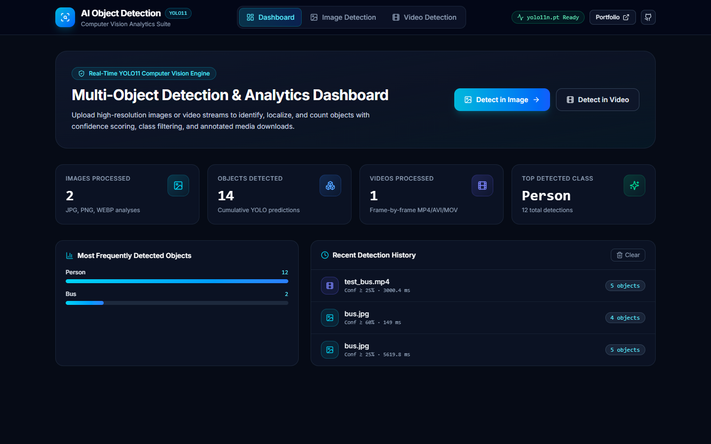
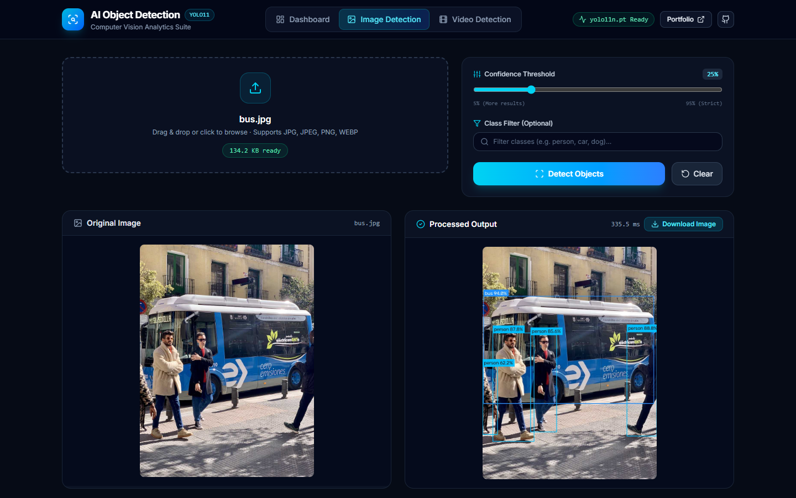

# AI Object Detection System

An end-to-end computer vision web application and three-page project portfolio powered by **Ultralytics YOLO11**, **OpenCV**, **FastAPI**, and **React + TypeScript**.

## Project Overview

The **AI Object Detection System** identifies, localizes, and counts multiple objects across uploaded images and videos in real time. It pairs a Python/YOLO11 REST API backend with an interactive dark-themed React analytics dashboard and a three-page portfolio website configured for GitHub Pages deployment.

## Problem Statement

Manual inspection of images and video footage for object identification and counting is time-consuming, inconsistent, and difficult to scale. Command-line deep learning tools are also inaccessible to non-technical users who need an intuitive visual interface to upload media, tune confidence thresholds, filter classes, and export annotated results.

## Objectives

- Detect and label multiple objects within single images and video frames using **YOLO11**.
- Draw crisp bounding boxes with class names and confidence percentages.
- Aggregate object counts and confidence scores into a structured results table.
- Track cumulative analytics and recent detection history in a clean dashboard.
- Allow users to filter by object class, adjust confidence thresholds, and download processed media.
- Present the system through a professional three-page portfolio website deployed on GitHub Pages.

## Features

- **Analytics Dashboard**: Displays total images processed, total objects detected, total videos processed, top detected classes, and recent detection history.
- **Image Object Detection**: Supports `JPG`, `JPEG`, `PNG`, and `WEBP` uploads with instant preview, bounding box rendering, structured summary table, and processed image download.
- **Video Object Detection**: Supports `MP4`, `AVI`, and `MOV` uploads with frame-by-frame YOLO11 processing, real-time progress bar, HTML5 playback, and processed video download.
- **Interactive Controls**: Confidence threshold slider (`5%`–`95%`) and dynamic 80-class COCO object filter.
- **Three-Page Portfolio Website**: Home, About the Project, and Contact & Project Links pages with responsive navigation and GitHub Pages automation.

## Technologies Used

- **AI & Computer Vision**: Python 3.11+, Ultralytics YOLO11, OpenCV, NumPy, PyTorch
- **Backend API**: FastAPI, Uvicorn, Pydantic, Python Multipart
- **Frontend & Portfolio**: React 19, TypeScript, Vite, Tailwind CSS v4, Lucide React, React Router
- **Deployment**: GitHub, GitHub Actions, GitHub Pages

## System Architecture

```text
┌─────────────────────────────┐      REST / Multipart      ┌─────────────────────────────┐
│   React + TypeScript UI     │ ─────────────────────────▶ │     FastAPI Backend         │
│  (frontend/ & portfolio/)   │ ◀───────────────────────── │      (backend/app.py)       │
└─────────────────────────────┘   JSON + Annotated Media   └──────────────┬──────────────┘
                                                                          │
                                                                          ▼
                                                           ┌─────────────────────────────┐
                                                           │  YOLO11 + OpenCV Engine     │
                                                           │   (backend/detector.py)     │
                                                           └─────────────────────────────┘
```

## Installation Instructions

### 1. Clone the Repository

```bash
git clone https://github.com/Mozjr1303/ai-object-detection-system.git
cd ai-object-detection-system
```

### 2. Backend Setup (Python 3.11+)

```bash
cd backend
python -m venv .venv
# Windows (PowerShell):
.\.venv\Scripts\Activate.ps1
# macOS / Linux:
# source .venv/bin/activate

pip install --upgrade pip
pip install -r requirements.txt
```

> **Model Weights**: On first run, `ultralytics` automatically downloads `yolo11n.pt` into `models/`. See [`models/README.md`](models/README.md) for manual download instructions.

### 3. Frontend Setup

```bash
cd ../frontend
npm install
```

### 4. Portfolio Setup

```bash
cd ../portfolio
npm install
```

## How to Run the Backend

From the `backend/` directory (with the virtual environment activated):

```bash
uvicorn app:app --host 0.0.0.0 --port 8000 --reload
```

The API will be available at `http://localhost:8000` (interactive docs at `http://localhost:8000/docs`).

## How to Run the Frontend

From the `frontend/` directory:

```bash
npm run dev
```

Open `http://localhost:5173` in your browser. Vite automatically proxies `/api/*` requests to `http://127.0.0.1:8000`.

To preview the three-page portfolio locally from `portfolio/`:

```bash
npm run dev
```

## How to Use the Application

1. Start both the **FastAPI backend** (`port 8000`) and **React frontend** (`port 5173`).
2. Open the dashboard at `http://localhost:5173` and verify the top-right status pill shows **`yolo11n.pt Ready`**.
3. Switch to **Image Detection**, upload a JPG/PNG/WEBP file, optionally adjust the **Confidence Threshold** or **Class Filter**, and click **Detect Objects**.
4. Inspect the annotated image and structured **Detection Results** table, then click **Download Image**.
5. Switch to **Video Detection**, upload an MP4/AVI/MOV file, click **Process Video**, monitor the frame-by-frame progress bar, and play or download the annotated MP4.

## Screenshots

| Dashboard Overview | Image Object Detection |
| :---: | :---: |
|  |  |

## Project Links

- **GitHub Repository**: [https://github.com/Mozjr1303/ai-object-detection-system](https://github.com/Mozjr1303/ai-object-detection-system)
- **Portfolio Website (GitHub Pages)**: [https://mozjr1303.github.io/ai-object-detection-system/](https://mozjr1303.github.io/ai-object-detection-system/)

## Developer Information

- **Developer**: Moses Aaron Makunganya
- **Role**: Full-Stack Developer & Computer Vision Engineer
- **License**: MIT License (see [`LICENSE`](LICENSE))
